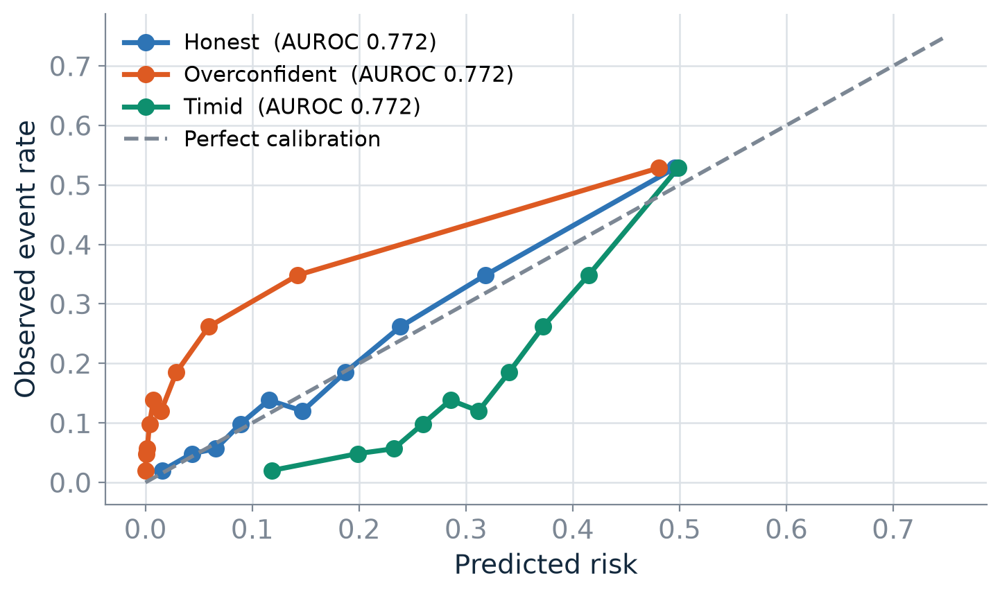
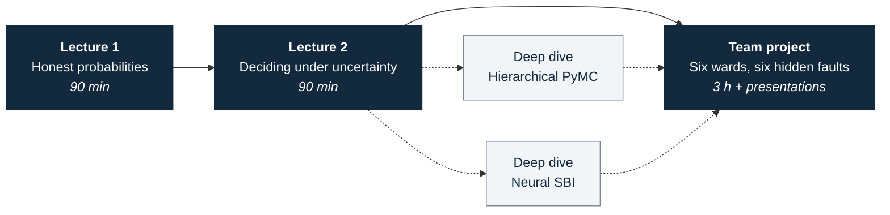
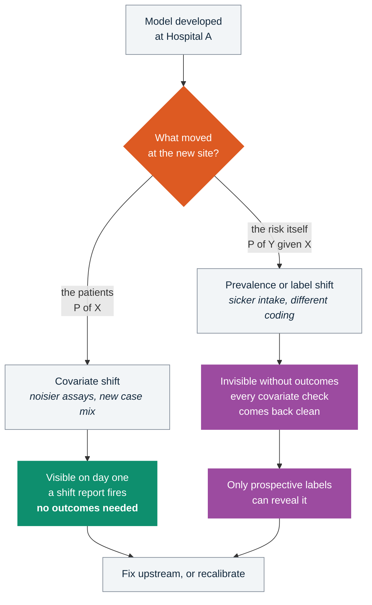

# Trustworthy medical AI under real-world uncertainty

**Healthcare AI module for the [AI & Uncertainty School and Workshop 2026](https://ai-uncertainty-workshop.github.io/2026/) - Mauritius, 16-20 November 2026**

[](https://colab.research.google.com/github/vafaei-ar/ai-uncertainty-2026-healthcare/blob/main/notebooks/01_lecture1_uncertainty_foundations_student.ipynb)
[](https://www.python.org/)
[](https://colab.research.google.com/)
[](#the-simulator)
[](LICENSE)

> [!NOTE]
> **The question the whole module is built around:**
> *Can you build a clinical prediction system that knows when it should not be trusted?*

Two 90-minute lectures, two deep-dive notebooks, and a three-hour team project.
Everything runs on the free Google Colab CPU tier against a synthetic EHR
simulator: no credentialed data, no GPU, no local install.

---

## Start here

Click a badge. Nothing to install, nothing to download.

| # | Notebook | What it covers | Run |
|:-:|---|---|:-:|
| 1 | **Honest probabilities in clinical prediction** | Bayesian updating · discrimination vs calibration · epistemic vs aleatoric · distribution shift · informative missingness | [](https://colab.research.google.com/github/vafaei-ar/ai-uncertainty-2026-healthcare/blob/main/notebooks/01_lecture1_uncertainty_foundations_student.ipynb) |
| 2 | **Deciding under uncertainty** | Recalibration · ensemble uncertainty · selective prediction · decision thresholds and net benefit · subgroup reliability · partial pooling | [](https://colab.research.google.com/github/vafaei-ar/ai-uncertainty-2026-healthcare/blob/main/notebooks/02_lecture2_trustworthy_deployment_student.ipynb) |
| 3 | **Hierarchical models in PyMC** | Varying intercepts and slopes across hospitals · shrinkage · posterior predictive checks | [](https://colab.research.google.com/github/vafaei-ar/ai-uncertainty-2026-healthcare/blob/main/notebooks/03_hierarchical_pymc_student.ipynb) |
| 4 | **Simulation-based inference** | ABC vs neural posterior estimation with `sbi` · amortised inference · a coverage check | [](https://colab.research.google.com/github/vafaei-ar/ai-uncertainty-2026-healthcare/blob/main/notebooks/04_simulation_based_inference_student.ipynb) |
| P | **Team project starter** | Loads your team's data and runs the first comparison that should make you suspicious | [](https://colab.research.google.com/github/vafaei-ar/ai-uncertainty-2026-healthcare/blob/main/notebooks/90_team_project_starter.ipynb) |

The lecture notebooks run in about ten seconds each; the two deep-dives take
about a minute. Instructor copies live beside each student file - same links
with `_instructor` in place of `_student`.

<details>
<summary><b>Instructor notebooks</b> - worked solutions and teaching notes</summary>

<br>

| Notebook | Run |
|---|:-:|
| Lecture 1 · instructor | [](https://colab.research.google.com/github/vafaei-ar/ai-uncertainty-2026-healthcare/blob/main/notebooks/01_lecture1_uncertainty_foundations_instructor.ipynb) |
| Lecture 2 · instructor | [](https://colab.research.google.com/github/vafaei-ar/ai-uncertainty-2026-healthcare/blob/main/notebooks/02_lecture2_trustworthy_deployment_instructor.ipynb) |
| Hierarchical PyMC · instructor | [](https://colab.research.google.com/github/vafaei-ar/ai-uncertainty-2026-healthcare/blob/main/notebooks/03_hierarchical_pymc_instructor.ipynb) |
| Simulation-based inference · instructor | [](https://colab.research.google.com/github/vafaei-ar/ai-uncertainty-2026-healthcare/blob/main/notebooks/04_simulation_based_inference_instructor.ipynb) |

Both variants are generated from a single source in `notebooks/source/`, so they
cannot drift apart.

</details>

---

## The idea in one picture

Three models. Identical AUROC to four decimal places. Three completely different
claims about what will happen to a patient.



AUROC measures *order*. Calibration measures *meaning*. Deployment breaks meaning
first, and AUROC is blind to it by construction.

---

## How the module fits together



---

## The argument

A model that scores well is not a model you can switch on. What actually goes
wrong when a risk model moves to a second hospital, and which check would have
caught it:



> [!IMPORTANT]
> Most deployed monitoring is an input-drift dashboard. It catches the left-hand
> branch and is **structurally blind** to the right-hand one. Prospective label
> collection is not optional infrastructure - it *is* the monitoring system.

---

## The simulator

`medsim.simulate_ehr` generates admissions with vitals, labs and comorbidities
and a 48-hour deterioration outcome. Every failure mode is a named argument, so
you can turn one on, watch what it does to the metrics, and turn it off again.

```python
from medsim import SimConfig, simulate_ehr

cohort = simulate_ehr(SimConfig(
    n=5000,
    site="B",
    prevalence_shift=0.5,       # baseline risk differs between hospitals
    measurement_noise=2.5,      # instruments and assays drift
    missingness_strength=1.4,   # labs are ordered for a reason
    label_noise=0.15,           # chart review is imperfect
    subgroup_shift=1.0,         # a subgroup carries different baseline risk
    subgroup_interaction=-1.8,  # ...or a different risk relationship entirely
    ood_fraction=0.30,          # patients unlike anything in development
))
```

<details>
<summary><b>Two design choices worth knowing about</b></summary>

<br>

**There is an unrecorded variable, on purpose.** The generator carries a
"clinical concern" term that moves the outcome and appears in no column - the
structured-EHR equivalent of the thing the nurse noticed at the bedside. It puts
a real ceiling on what any model can achieve here:

| | AUROC |
|---|---|
| A fitted logistic regression | ≈ 0.72 |
| Ceiling on the recorded columns | ≈ 0.73 |
| Oracle that also sees the unrecorded impression | ≈ 0.78 |

So the gap to a perfect model is not laziness, and the way to move the ceiling is
to record something new rather than to fit a deeper network to the same columns.
The aleatoric floor is demonstrable rather than asserted.

**Missingness is driven by that same unrecorded variable.** A lab is missing
because nobody ordered it, and nobody ordered it because nobody was worried. So a
blank cell genuinely carries information that median imputation destroys - and
complete-case analysis silently selects the sickest half of the ward.

</details>

---

## Team project

Six teams, one task, identical columns - and six different reasons the model
should not be switched on. Teams are the reviewers: they get development data and
six months of deployment data, and have to say what is wrong, who it is wrong
for, when the model should refuse to answer, and whether they would deploy it.

> [!TIP]
> **The task is not to raise AUROC.** A team that improves AUROC by 0.02 and
> cannot say who the model fails for has not done the work. A team that leaves
> AUROC untouched and correctly identifies the patients it must not be used on
> has.

- [`project/PROJECT_BRIEF.md`](project/PROJECT_BRIEF.md) - the brief, and a
  suggested route through the three hours
- [`project/RUBRIC.md`](project/RUBRIC.md) - how it is marked; diagnosis and
  honesty outweigh modelling
- `project/data/` - pre-generated cohorts, one pair per team

> [!WARNING]
> **Participants: do not open `project/ANSWER_KEY.md`.** It names every hidden
> failure mode and would turn a three-hour investigation into a five-minute
> lookup.

---

## Repository layout

<details>
<summary><b>What lives where</b></summary>

<br>

```
medsim/           simulator and evaluation metrics
notebooks/        built notebooks (student + instructor)
notebooks/source/ notebook sources - edit these, not the .ipynb files
project/          team datasets, brief, rubric, instructor answer key
slides/           lecture decks, their figures, and the generators
docs/             lecture and project plan for the organisers
tools/            notebook builder and headless runner
archive/          the September 2026 prototype, superseded
```

`medsim.metrics` provides `performance_table`, `calibration_table`,
`expected_calibration_error`, `subgroup_report`, `shift_report`,
`selective_risk_curve` and `bootstrap_ensemble`.

</details>

<details>
<summary><b>Running or rebuilding it locally</b></summary>

<br>

```bash
pip install -r requirements.txt              # lectures + team project
pip install -r requirements-deep-dive.txt    # adds PyMC, torch, sbi

python notebooks/source/lecture1.py          # rebuild a notebook pair
python project/make_team_data.py             # regenerate team datasets
python project/check_signatures.py           # verify every failure mode is still detectable
python slides/make_figures.py                # re-render the slide figures
python tools/run_notebook.py notebooks/01_lecture1_uncertainty_foundations_instructor.ipynb
```

Seeds are fixed throughout, so regenerating reproduces the reference numbers in
the instructor answer key.

</details>

---

## Slides

Both lecture decks are in [`slides/`](slides/), with speaker notes. They are
generated rather than hand-built: `slides/make_figures.py` renders every figure
from the same `medsim` code the notebooks use, and `slides/src/` holds the deck
generators - so a number on a slide cannot drift from the number in the notebook.

---

## For the organisers

[`docs/lecture_and_project_plan.md`](docs/lecture_and_project_plan.md) has the
minute-by-minute plan for both lectures, the project structure, scheduling
requirements, and the open questions.

---

<sub>Alireza Vafaei Sadr · Penn State College of Medicine · material for the AI &
Uncertainty School and Workshop 2026</sub>
