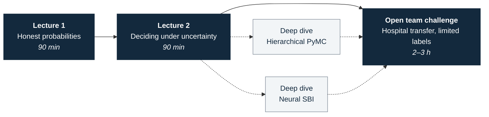
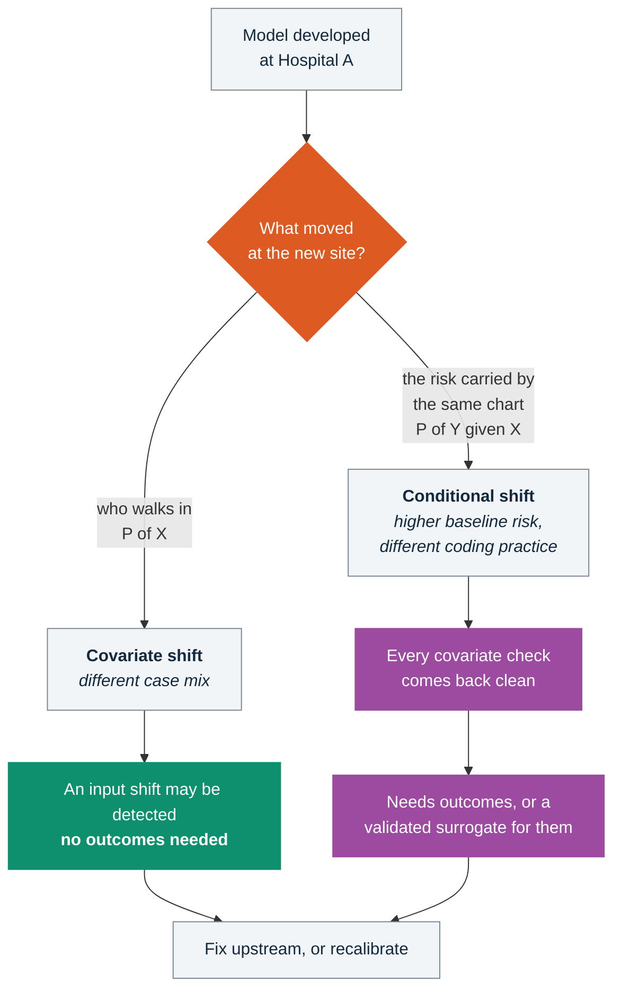

# Trustworthy medical AI under real-world uncertainty

**Healthcare AI module for the [AI & Uncertainty School and Workshop 2026](https://ai-uncertainty-workshop.github.io/2026/) - Mauritius, 16-20 November 2026**

[](https://colab.research.google.com/github/vafaei-ar/ai-uncertainty-2026-healthcare/blob/main/notebooks/01_lecture1_uncertainty_foundations_student.ipynb)
[](https://www.python.org/)
[](https://colab.research.google.com/)
[](#the-simulator)
[](LICENSE)

> [!NOTE]
> **The question the whole module is built around:**
> *Can you build a clinical prediction system that knows when it should not be trusted?*

Two lectures prepared for either **60 or 90 minutes**, optional Bayesian/SBI deep dives,
and an **open two- to three-hour team challenge**. The older six-team guided exercise
is kept as a backup. Core exercises use synthetic EHR-like data on free Colab CPU:
no credentialed data, GPU, or local installation. Workshop timing is not yet confirmed.

---

## Start here

Click a badge. Nothing to install, nothing to download.

| # | Notebook | What it covers | Run |
|:-:|---|---|:-:|
| 1 | **Honest probabilities in clinical prediction** | Bayesian updating · discrimination vs calibration · epistemic vs aleatoric · distribution shift · informative missingness | [](https://colab.research.google.com/github/vafaei-ar/ai-uncertainty-2026-healthcare/blob/main/notebooks/01_lecture1_uncertainty_foundations_student.ipynb) |
| 2 | **Deciding under uncertainty** | Recalibration · ensemble uncertainty · selective prediction · decision thresholds and net benefit · subgroup reliability · partial pooling | [](https://colab.research.google.com/github/vafaei-ar/ai-uncertainty-2026-healthcare/blob/main/notebooks/02_lecture2_trustworthy_deployment_student.ipynb) |
| 3 | **Hierarchical models in PyMC** | Varying intercepts and slopes across hospitals · shrinkage · posterior predictive checks | [](https://colab.research.google.com/github/vafaei-ar/ai-uncertainty-2026-healthcare/blob/main/notebooks/03_hierarchical_pymc_student.ipynb) |
| 4 | **Simulation-based inference** | ABC vs neural posterior estimation with `sbi` · amortised inference · a coverage check | [](https://colab.research.google.com/github/vafaei-ar/ai-uncertainty-2026-healthcare/blob/main/notebooks/04_simulation_based_inference_student.ipynb) |
| P | **Open hospital-transfer challenge (default)** | Limited target-site labels; teams decide how to evaluate, recalibrate, defer or stay in shadow mode | [](https://colab.research.google.com/github/vafaei-ar/ai-uncertainty-2026-healthcare/blob/main/notebooks/91_open_research_challenge_starter.ipynb) |
| G | **Guided team project (backup)** | Structured exercise with different hidden failure modes | [](https://colab.research.google.com/github/vafaei-ar/ai-uncertainty-2026-healthcare/blob/main/notebooks/90_team_project_starter.ipynb) |

The lecture notebooks run in about ten seconds each; the two deep-dives take
about a minute. Instructor copies live beside each student file - same links
with `_instructor` in place of `_student`.

<details>
<summary><b>Instructor notebooks</b> - worked solutions and teaching notes</summary>

<br>

| Notebook | Run |
|---|:-:|
| Lecture 1 · instructor | [](https://colab.research.google.com/github/vafaei-ar/ai-uncertainty-2026-healthcare/blob/main/notebooks/01_lecture1_uncertainty_foundations_instructor.ipynb) |
| Lecture 2 · instructor | [](https://colab.research.google.com/github/vafaei-ar/ai-uncertainty-2026-healthcare/blob/main/notebooks/02_lecture2_trustworthy_deployment_instructor.ipynb) |
| Hierarchical PyMC · instructor | [](https://colab.research.google.com/github/vafaei-ar/ai-uncertainty-2026-healthcare/blob/main/notebooks/03_hierarchical_pymc_instructor.ipynb) |
| Simulation-based inference · instructor | [](https://colab.research.google.com/github/vafaei-ar/ai-uncertainty-2026-healthcare/blob/main/notebooks/04_simulation_based_inference_instructor.ipynb) |

Both variants are generated from a single source in `notebooks/source/`, so they
cannot drift apart.

</details>

---

## The idea in one picture

Three models, nearly identical rankings, but very different risk probabilities.


AUROC measures ranking; calibration asks whether stated probabilities agree with observed outcomes. Hospital transfer **can** break calibration even when AUROC barely changes.

---

## How the module fits together



---

## The argument

A model that scores well is not automatically ready for patient care. This simplified example contrasts shifts visible in observed inputs with changes in conditional risk that may not be:



**Which shift is which.** These names get used loosely, and this is a school where
people will know the difference:

| Name | What moves | What is assumed stable |
|---|---|---|
| Covariate shift | $P(X)$ | $P(Y \mid X)$ |
| Label (prior probability) shift | $P(Y)$ | $P(X \mid Y)$ |
| Conditional (concept) shift | $P(Y \mid X)$ | - |

The simulator's `prevalence_shift` and `site` arguments add a constant on the
logit scale while leaving the covariate distribution alone. That is a
**conditional shift** - specifically a baseline-risk shift that shows up as
miscalibration - and *not* label shift, whose classical assumption of a stable
$P(X \mid Y)$ is violated here.

> [!IMPORTANT]
> Most deployed monitoring is an input-drift dashboard, and input monitoring
> alone cannot establish that $P(Y \mid X)$ has stayed put. **The absence of
> observed input drift is not evidence that the model is still valid.**
> Confirming that it is takes outcome data, or a surrogate you have validated
> against outcomes.

---

## The simulator

`medsim.simulate_ehr` generates admissions with vitals, labs and comorbidities
and a 48-hour deterioration outcome. Every failure mode is a named argument, so
you can turn one on, watch what it does to the metrics, and turn it off again.

```python
from medsim import SimConfig, simulate_ehr

cohort = simulate_ehr(SimConfig(
    n=5000,
    site="B",
    prevalence_shift=0.5,       # baseline risk differs between hospitals
    measurement_noise=2.5,      # instruments and assays drift
    missingness_strength=1.4,   # labs are ordered for a reason
    label_noise=0.15,           # chart review is imperfect
    subgroup_shift=1.0,         # a subgroup carries different baseline risk
    subgroup_interaction=-1.8,  # ...or a different risk relationship entirely
    ood_fraction=0.30,          # patients unlike anything in development
))
```

<details>
<summary><b>Two design choices worth knowing about</b></summary>

<br>

**There is an unrecorded variable, on purpose.** The generator carries a
"clinical concern" term that moves the outcome and appears in no column - the
structured-EHR equivalent of the thing the nurse noticed at the bedside. It puts
a real ceiling on what any model can achieve here:

| | AUROC |
|---|---|
| A fitted logistic regression | ≈ 0.72 |
| Ceiling on the recorded columns | ≈ 0.73 |
| Oracle that also sees the unrecorded impression | ≈ 0.78 |

So the gap to a perfect model is not laziness, and the way to move the ceiling is
to record something new rather than to fit a deeper network to the same columns.
The aleatoric floor is demonstrable rather than asserted.

**Missingness is driven by that same unrecorded variable.** A lab is missing
because nobody ordered it, and nobody ordered it because nobody was worried. So a
blank cell genuinely carries information that median imputation destroys - and
complete-case analysis silently selects the sickest half of the ward.

</details>

---

## Team project

**Default: an open research problem.** Hospital A developed a 48-hour deterioration
risk model; Hospital B wants to use it but most of its outcome labels are not
available. Teams get 4,000 labeled source records, 1,600 unlabeled target records,
and a random audit of **75** target outcomes. There is a provisional 20%
additional review budget. They must decide what evidence supports trusting,
adapting, deferring, or withholding predictions, and what additional outcomes
should be collected.

There is **no single answer**, no formal grading, and no expectation that input
monitoring or bootstrap uncertainty alone can certify safe transfer. The
best team presentation states what it knows, what it cannot know, and what
it recommends for shadow-mode evaluation. This is a teaching simulation,
**not a clinical validation or a real patient-care decision**.

- [Open challenge brief](project/OPEN_RESEARCH_CHALLENGE.md)
- [Colab starter](notebooks/91_open_research_challenge_starter.ipynb)
- [Reproducible data generator](project/generate_open_challenge.py), with CSVs under project/open_data/

**Guided backup:** the existing six-hospital diagnostic exercise remains available
if the programme prefers a more structured project. See
[guided project brief](project/PROJECT_BRIEF.md) and
[guided starter notebook](notebooks/90_team_project_starter.ipynb).
Its optional checklist is not a formal grading rubric.

---

## Repository layout

<details>
<summary><b>What lives where</b></summary>

<br>

```
medsim/           simulator and evaluation metrics
notebooks/        built notebooks (student + instructor)
notebooks/source/ notebook sources - edit these, not the .ipynb files
project/          open challenge generator/data/brief; guided data and debrief checklist
slides/           lecture decks, their figures, and the generators
docs/             lecture and project plan for the organisers
tools/            notebook builder and headless runner
archive/          the September 2026 prototype, superseded
```

`medsim.metrics` provides `performance_table`, `calibration_table`,
`expected_calibration_error`, `subgroup_report`, `shift_report`,
`selective_risk_curve` and `bootstrap_ensemble`.

</details>

<details>
<summary><b>Running or rebuilding it locally</b></summary>

<br>

```bash
pip install -r requirements.txt              # lectures + team project
pip install -r requirements-deep-dive.txt    # adds PyMC, torch, sbi

python notebooks/source/lecture1.py          # rebuild a notebook pair
python project/generate_open_challenge.py   # generate open-challenge datasets
python notebooks/source/open_research_challenge.py # build its Colab starter
python slides/make_figures.py                # re-render the slide figures
python tools/run_notebook.py notebooks/01_lecture1_uncertainty_foundations_instructor.ipynb
```

Seeds are fixed throughout, so anything you regenerate is reproducible. The guided exercise's answer key is kept separate; the open exercise has no fixed answer.

</details>

---

## Slides

Both lecture decks are in [`slides/`](slides/), with speaker notes. They are
generated rather than hand-built: `slides/make_figures.py` renders every figure
from the same `medsim` code the notebooks use, and `slides/src/` holds the deck
generators - so a number on a slide cannot drift from the number in the notebook.

---

## For the organisers

[`docs/lecture_and_project_plan.md`](docs/lecture_and_project_plan.md) has the
minute-by-minute plan for both lectures, the project structure, scheduling
requirements, and the open questions.

---

<sub>Alireza Vafaei Sadr · Penn State College of Medicine · material for the AI &
Uncertainty School and Workshop 2026</sub>
